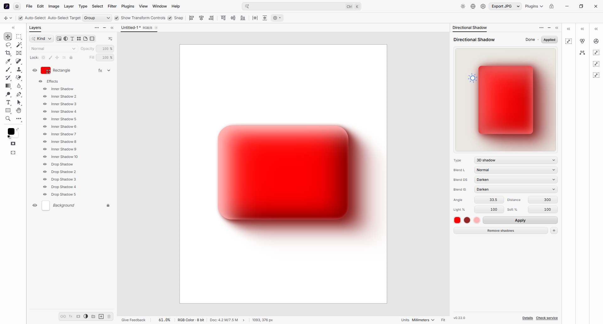
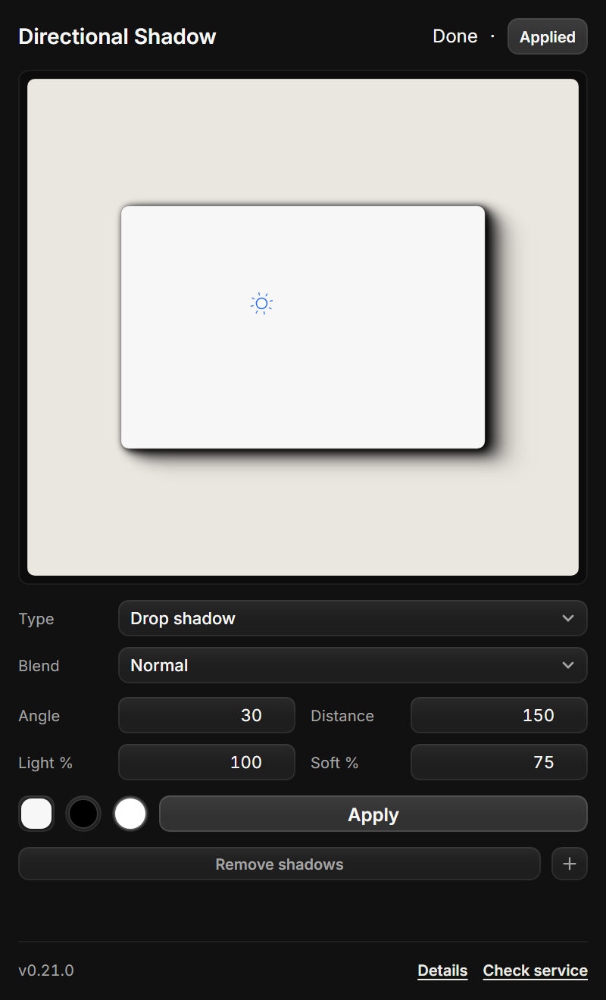
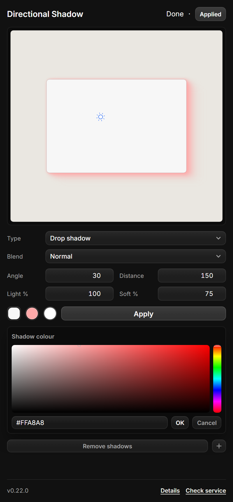
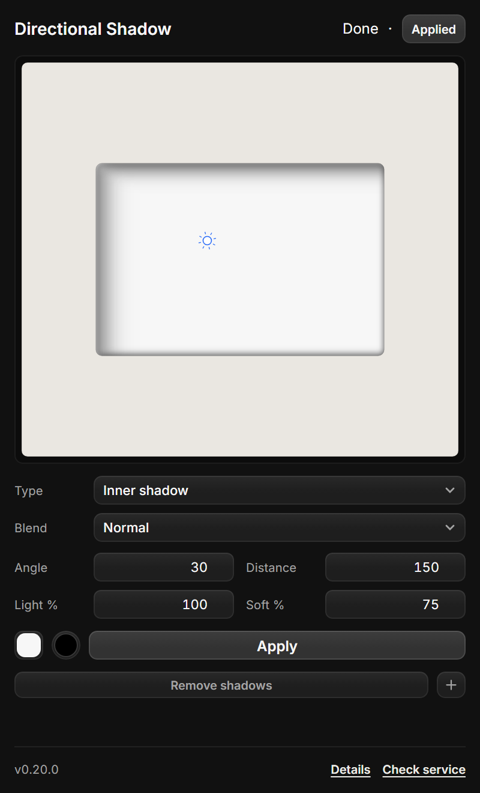

# Directional Shadow — Photon Studio plugin

Soft directional shadow for any layer, modelled on the Figma plugin **Beautiful Shadows** and the
Affinity Photo macro *Directional Blur Shadow* (original concept by `rbonelli`).

Apply adds **five cascaded layer styles** to the selected layer in one `layer.effects.set` call, so
the result is a single undo step, stays editable in Photon's Layer Style panel, and never duplicates
the layer.

## Screenshots

| Drop shadow (default) | Colour picker | Inner shadow |
| --- | --- | --- |
|  |  |  |

## Design system

Panel styling, components and tokens follow [`../design-system`](../design-system/README.md):
24 px controls, 7 px control radius, 12 px floating surfaces, the canonical `select.js`
dropdown and the shared header/footer contract.

## Install

1. Photon Studio → **Preferences → Plug-ins → Install plugin** → select this repository's
   `plugin/` folder.
2. Select a layer and open **Plugins → Directional Blur Shadow…** (`Ctrl+Shift+D`).

No service, no network, no dependencies.

## Use

Drag the sun to aim the shadow (it falls on the opposite side), then press **Apply**.
**Remove shadows** restores the styles from before the last Apply; applying again replaces the
previous result instead of stacking.

| Field | Range | Default | Meaning |
| --- | --- | --- | --- |
| `A °` | 0–360 | 30 | Shadow direction: 0° right, 90° down |
| `D px` | 1–300 | 150 | How far the shadow travels |
| `Light %` | 1–100 | 100 | Scales every layer's opacity |
| `Soft %` | 1–100 | 75 | Scales the blur of every step |
| `Type` | Drop / Inner shadow | Drop | Which layer style to write (Advanced) |
| `Blend` | Photoshop blend list | Normal | Forwarded to the host when layer styles expose a blend parameter; the preview always shows it |
| white card | click | `#f7f7f7` | Click it in the preview to pick the preview object's colour |
| swatch | picker | black | Shadow colour (own HSV picker, verified against Photon) |

Five fixed steps (farthest → nearest). Offsets are `distance × 1 / .64 / .36 / .16 / .04`, opacities
`lighting × 2 / 15 / 50 / 85 / 98 %`, and each shadow has its **own blur**:
`distance × .283 / .258 / .215 / .160 / .086 × soft`. At `D 163 px` and `Soft 100 %` that is
46 / 42 / 35 / 26 / 14 px — the Figma plugin's own column.

Photon's shadow angle is the **light** direction on a Photoshop dial (0° right, 90° up), so a shadow
pointing at θ is written as `180 − θ`.

## Testing

```powershell
node tools/shadow-test.cjs     # 21 tests: presets, angle, payloads, styles
node tools/colour-test.cjs     # 6 tests: hex/rgb/hsv maths for the picker
node tools/bench.cjs           # operation counts and maths timings
```

An Apply sends four operations: `documents.active` ×2, `effect.describe`, `layer.effects.set`.

## Limits

- Use **Apply** to commit; the canvas preview is an approximation, not a render of the result.
- Layer styles cannot be removed individually by the plugin API, so **Remove shadows** restores the
  whole styles snapshot.

MIT licensed — see [LICENSE](LICENSE).

## Changelog

### 0.15.2

- The Type and Blend rows are no longer `<label>` wrappers: a label around a nested `<select>`
  let Photon open the native menu on top of the custom trigger. The native select is also pinned
  hidden, and the popup keeps the 12 px floating radius.

### 0.15.1

- Fixed the custom dropdown: the select wrapper no longer clips the popup, and the trigger/value
  uses the design-system text colour instead of inheriting the small-label grey.
- Stored angles and distances are rounded to one decimal, so old settings no longer render as
  `213.20000000000005`; dragged values already were rounded.

### 0.15.0

- Values use a clean 2x2 grid (label + compact field, 100 % width) like Photon's own property rows.
- Type and the new **Blend** dropdown moved into an Advanced section; the blend list covers the
  full Photoshop set and the preview composites with the matching canvas mode where one exists.
- Click the white card in the preview to choose its colour; the choice is remembered with the
  panel settings.
- Dragged angles/distances are rounded to one decimal instead of exposing long floats.

### 0.14.5

- The preview is now a square, centred stage; the white card sits in the middle.
- The Drop Shadow values moved out of the canvas: they form a normal panel below the preview and
  above the Apply button, so the preview is no longer covered.

### 0.14.4

- The light handle now follows the Distance control all the way to 300 px (126 canvas px at the
  preview scale) and stops only at the canvas edge instead of an early 74 px cap.

### 0.14.3

- Removed the dashed guide line between the card and the light handle; the handle and sun rays
  stay, and the preview is cleaner.

### 0.14.2

- Header now carries the design-system activity word (`Idle · Ready`) alongside the badge.
- The shadow Type dropdown uses the canonical `select.js` component (custom glass menu)
  instead of the native OS menu.

