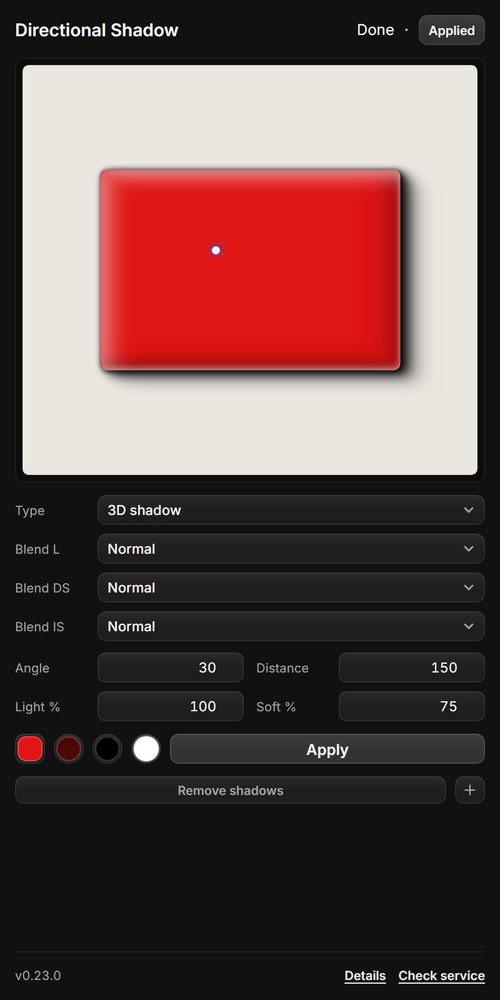

# Directional Shadow — Photon Studio plugin

Soft directional shadow for any layer, modelled on the Figma plugin **Beautiful Shadows** and the
Affinity Photo macro *Directional Blur Shadow* (original concept by `rbonelli`).

Apply adds **five cascaded layer effects per shadow type** to the selected layer in one batched
`layer.effect.set` per step, so the result is a single undo step, stays editable in Photon's Layer
Style panel, and never duplicates the layer or touches its other effects. 3D shadow combines three
ramps: a drop shadow, a dark inner bevel and a light inner bevel.

## Screenshots

| Drop shadow (default) | Colour picker | Inner shadow | 3D shadow |
| --- | --- | --- | --- |
|  |  |  |  |

## Design system

Panel styling, components and tokens follow [`../design-system`](../design-system/README.md):
24 px controls, 7 px control radius, 12 px floating surfaces, the canonical `select.js`
dropdown and the shared header/footer contract.

## Install

1. Photon Studio → **Preferences → Plug-ins → Install plugin** → select this repository's
   `plugin/` folder.
2. Select a layer and open **Plugins → Directional Blur Shadow…** (`Ctrl+Shift+D`).

No service, no network, no dependencies.

## Use

Drag the sun to aim the shadow (it falls on the opposite side), then press **Apply**.
**Apply** writes the five shadows of the selected **Type** and leaves every other effect on the layer
alone, so applying again updates that type in place instead of stacking. The **+** button beside
**Remove shadows** adds the other 2D type: with Type set to Drop it adds an inner shadow, and with
Type set to Inner it adds a drop shadow, so the same layer can keep both.

**3D shadow** writes three ramps in one Apply: a drop shadow, a dark inner shadow on the side away
from the light, and a light inner shadow on the light side. In 3D mode the swatch row shows one
colour per component: inner shadow colour, drop shadow colour and lighting colour, each with its own
picker and remembered with the other panel settings. The single Blend row also becomes three:
**Blend L** for the lighting ramp, **Blend DS** for the drop shadow ramp and **Blend IS** for the
inner bevel ramp. The **+** button is disabled in 3D mode because both types are already part of it.

**Remove shadows** removes the ramps of the last written mode from the layer; applying again adds
them back.

| Field | Range | Default | Meaning |
| --- | --- | --- | --- |
| `Angle` | 0–360 | 30 | Shadow direction: 0° right, 90° down |
| `Distance` | 1–300 | 150 | How far the shadow travels |
| `Light %` | 1–100 | 100 | Scales every layer's opacity |
| `Soft %` | 1–100 | 75 | Scales the blur of every step |
| `Type` | Drop / Inner / 3D shadow | Drop | Which ramp set to write |
| `Blend` | Photoshop blend list | Normal | 2D modes: blend of the selected shadow type |
| `Blend L` | Photoshop blend list | Normal | 3D mode: blend of the lighting ramp |
| `Blend DS` | Photoshop blend list | Normal | 3D mode: blend of the drop shadow ramp |
| `Blend IS` | Photoshop blend list | Normal | 3D mode: blend of the inner shadow ramp |
| square swatch | custom picker | `#f7f7f7` | Preview box colour; also opens by clicking the white card |
| round swatch | custom picker | black | 2D modes: colour of the selected shadow type |
| inner swatch | custom picker | black | 3D mode: inner shadow colour |
| drop swatch | custom picker | black | 3D mode: drop shadow colour |
| ringed round swatch | custom picker | white | 3D mode: lighting colour |
| white card | click | `#f7f7f7` | Opens the box-colour picker |
| `+` button | click | always | Adds the shadow type that is not selected; disabled in 3D mode |

Five fixed steps (farthest → nearest). Offsets are `distance × 1 / .64 / .36 / .16 / .04`, opacities
`lighting × 2 / 15 / 50 / 85 / 98 %`, and each shadow has its **own blur**:
`distance × .283 / .258 / .215 / .160 / .086 × soft`. At `D 163 px` and `Soft 100 %` that is
46 / 42 / 35 / 26 / 14 px — the Figma plugin's own column.

Photon's shadow angle is the **light** direction on a Photoshop dial (0° right, 90° up), so a shadow
pointing at θ is written as `180 − θ`.

## Testing

```powershell
node tools/shadow-test.cjs     # 22 tests: presets, angles, typed payloads, 2D and 3D batches
node tools/colour-test.cjs     # 6 tests: hex/rgb/hsv maths for the picker
node tools/ui-check.cjs        # ids and el keys used by app.js exist in index.html
node tools/bench.cjs           # operation counts and maths timings
```

An Apply sends `documents.active`, one `effect.describe` per effect type, then one batch of
`layer.effect.set` calls: five for Drop or Inner, fifteen for 3D shadow.

## Limits

- Use **Apply** to commit; the canvas preview is an approximation, not a render of the result.
- Photon has no operation that deletes a single layer effect, so **Remove shadows** clears the
  `present` and `enabled` flags of the effects it last wrote. Photon drops them from the Layers panel
  and the render; applying again patches them back.
- 3D shadow writes fifteen effects (three ramps). Switching Type applies the new mode and removes the
  ramps that no longer belong to it in the same undo step.

MIT licensed — see [LICENSE](LICENSE).
